<p align="center">
  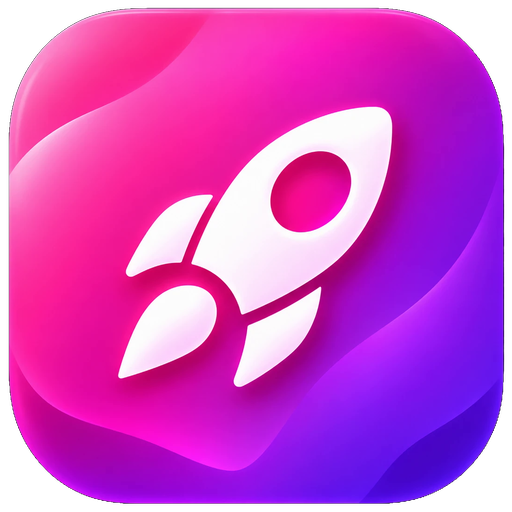
</p>

<h1 align="center">CapRocket</h1>

<p align="center">
  <b>The free, open-source desktop video editor in the style of CapCut.</b><br />
  Timeline editing · offline auto captions · GPU effects and transitions · text to speech · music and stock libraries · an AI assistant that edits for you.<br />
  <b>No account. No subscription. No watermark.</b>
</p>

<p align="center">
  <a href="https://github.com/medhachim/CapRocket/releases/download/v0.1.0/CapRocket-Setup-0.1.0.exe"></a>
  &nbsp;
  <a href="https://ko-fi.com/J3F024TQY1"></a><br />
  <sub>Windows 10 / 11 · 64-bit · about 120 MB · <a href="https://github.com/medhachim/CapRocket/releases">all versions</a></sub>
</p>

<p align="center">
  
  
  
  
  
  
  
  
</p>

<p align="center">
  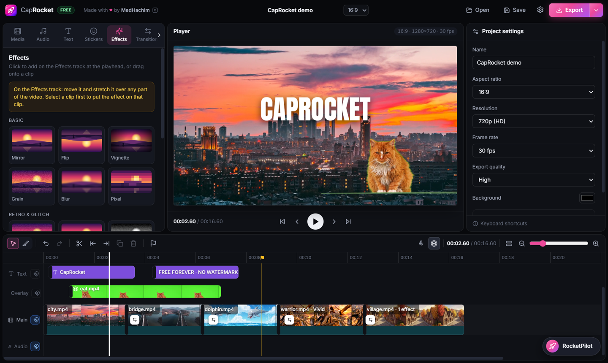
</p>

<p align="center">
  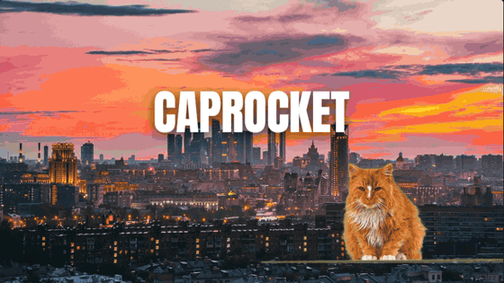<br />
  <sub>Real playback in the CapRocket player: Comic Cut and Flare Wipe transitions, a green-screen cat (chroma key) and text templates.</sub>
</p>

---

## Contents

- [Why CapRocket?](#why-caprocket)
- [Download and install](#download-and-install)
- [Tour of the app](#tour-of-the-app)
- [Features](#features)
- [How it is built](#how-it-is-built)
- [Run from source](#run-from-source)
- [API keys and privacy](#api-keys-and-privacy)
- [Contributing](#contributing)
- [Support the project](#support-the-project)
- [License and credits](#license-and-credits)

---

## Why CapRocket?

Most "free" editors lock their best tools behind a paid plan. CapRocket is built so that **everything is free**:
features that are premium elsewhere are part of the app, with no limit and no watermark.

| Usually paid elsewhere | In CapRocket |
|---|---|
| Auto captions | ✅ Free and offline with Whisper (Arabic and Darija included) |
| Background removal (green screen) | ✅ Chroma key with colour picker, feather and spill removal |
| Masks | ✅ Split, filmstrip, circle, rectangle, stars, heart, text |
| Animated effects and transitions | ✅ Rendered on the GPU, same picture in the player and the export |
| Text to speech | ✅ Free voices on your PC, or ElevenLabs with your own key |
| AI editing assistant | ✅ RocketPilot, with your own key |
| 4K export, audio-only export | ✅ No watermark, no limit |

It is a desktop app for Windows built with **Electron, React, WebGL and FFmpeg**. Your media stays on your computer;
online libraries are only contacted when you search them.

## Download and install

**[⬇ Download CapRocket-Setup-0.1.0.exe](https://github.com/medhachim/CapRocket/releases/download/v0.1.0/CapRocket-Setup-0.1.0.exe)** (Windows 10 / 11, 64-bit, about 120 MB)

Older and newer versions are on the [Releases page](https://github.com/medhachim/CapRocket/releases).

1. Download `CapRocket-Setup-0.1.0.exe` with the link above.
2. Run it, pick the install folder and finish. CapRocket appears on the Desktop and in the Start menu.
3. The first time, Windows SmartScreen may say *"Windows protected your PC"*: the installer is not code-signed yet.
   Click **More info**, then **Run anyway**.

Big optional parts are downloaded only when you first use them: the speech model for auto captions (about 150 MB)
and each text-to-speech voice (about 60 MB). Uninstall from *Settings > Apps* like any program.

## Tour of the app

The window follows the layout CapCut users already know:

```text
┌───────────────┬──────────────────────────────┬────────────────┐
│ Library       │ Player                       │ Inspector      │
│ Media, Audio, │ move · resize · rotate       │ settings of    │
│ Text, Effects,│ pictures right on the video  │ the selection  │
│ Transitions…  │                              │                │
├───────────────┴──────────────────────────────┴────────────────┤
│ Toolbar                                                        │
│ Timeline: Effects · Stickers · Text · Overlay · Main · Audio   │
└────────────────────────────────────────────────────────────────┘
```

### Edit right in the player
Click any picture in the player to select it, drag to move (it snaps to the centre), pull a corner to resize and the round handle to rotate.

<p align="center">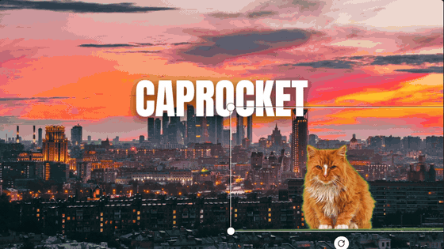</p>

### Live effects and transitions
Every tile is a live preview: hover it to see the effect or the transition play before you use it.

<table>
  <tr>
    <td align="center">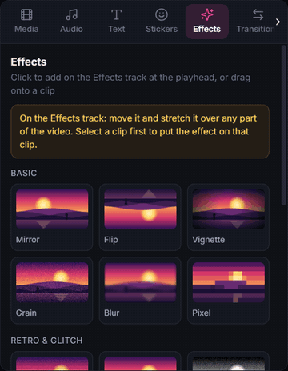<br /><sub><b>Effects</b>: VHS Noise, Snow Storm, Fire Burn, Limelight…</sub></td>
    <td align="center">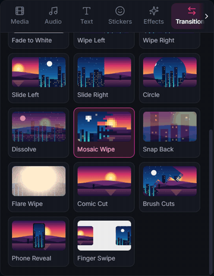<br /><sub><b>Transitions</b>: Comic Cut, Phone Reveal, Mosaic Wipe…</sub></td>
  </tr>
</table>

### Clip settings, transitions and the right-click menu

<table>
  <tr>
    <td align="center" width="33%">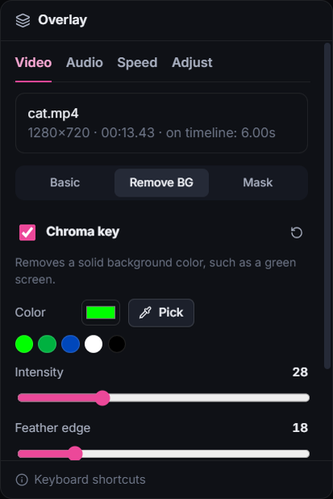<br /><sub><b>Remove BG</b>: chroma key</sub></td>
    <td align="center" width="33%">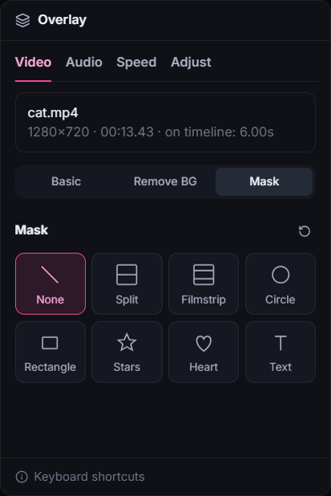<br /><sub><b>Masks</b> with feather and invert</sub></td>
    <td align="center" width="33%">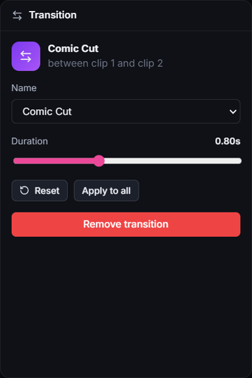<br /><sub><b>Transition</b>: type, duration, apply to all</sub></td>
  </tr>
</table>

<p align="center">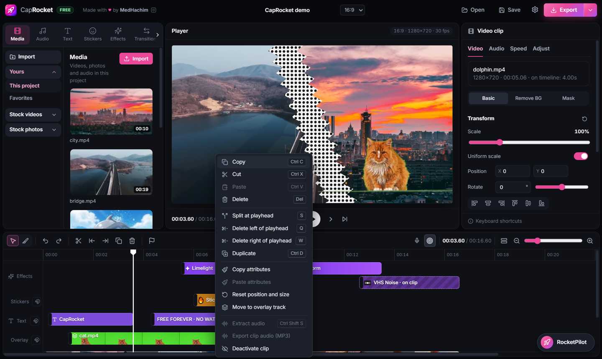<br />
<sub>Right-click a clip to copy / paste attributes, split, extract audio and more. Free effects sit on their own <b>Effects</b> lane.</sub></p>

### Libraries

<table>
  <tr>
    <td align="center" width="25%">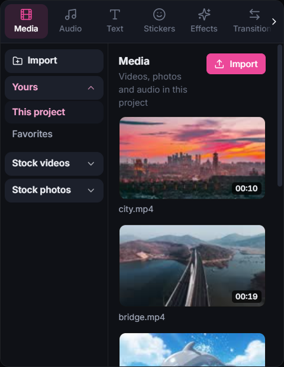<br /><sub><b>Media</b>, Pixabay stock, favorites</sub></td>
    <td align="center" width="25%">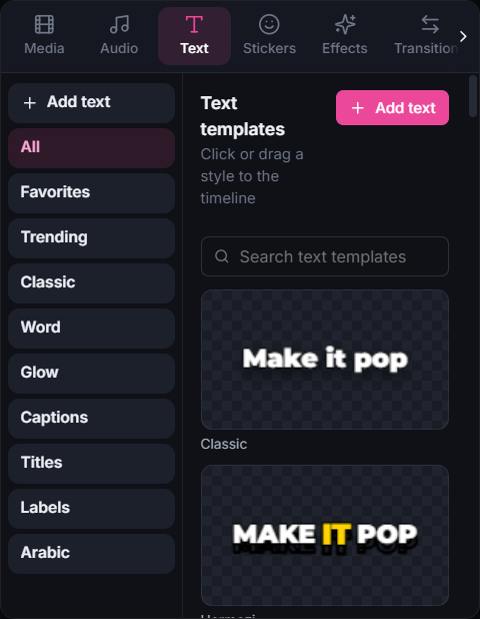<br /><sub><b>Text</b> and caption templates</sub></td>
    <td align="center" width="25%">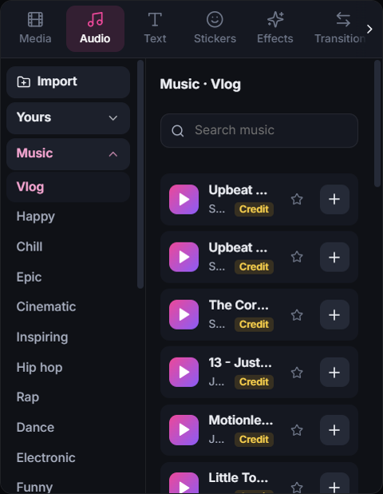<br /><sub><b>Music</b> and sound effects</sub></td>
    <td align="center" width="25%">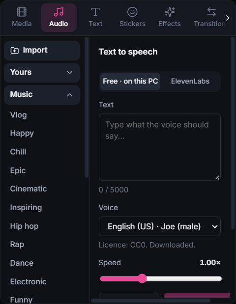<br /><sub><b>Text to speech</b></sub></td>
  </tr>
</table>

### RocketPilot and Settings

<table>
  <tr>
    <td align="center" width="50%">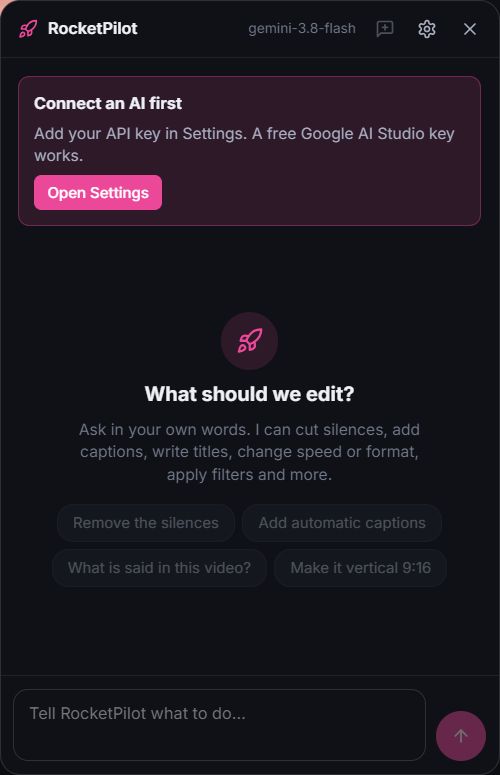<br /><sub><b>RocketPilot</b>: ask in your own words</sub></td>
    <td align="center" width="50%">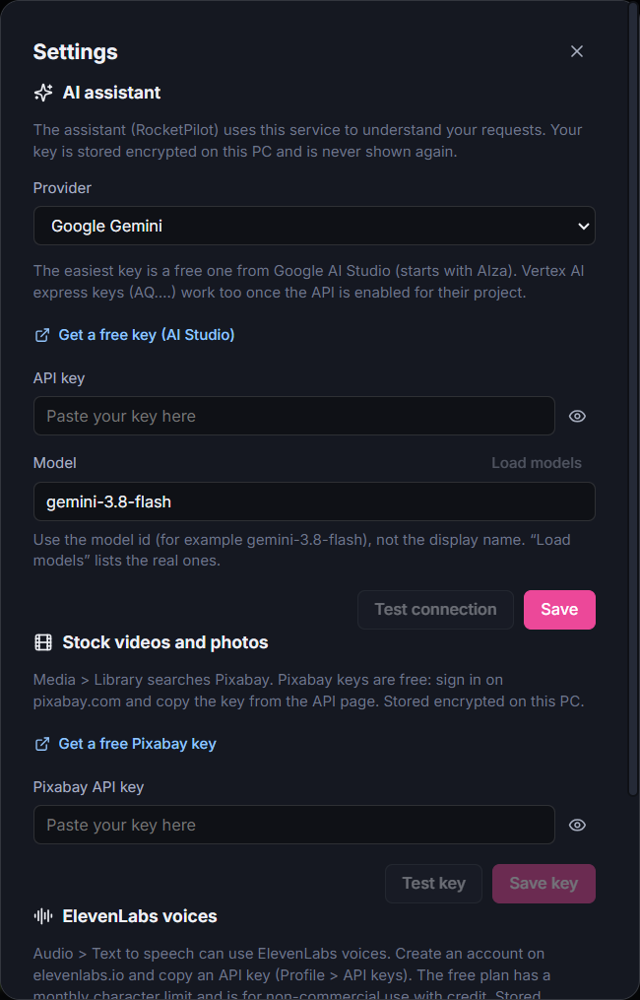<br /><sub><b>Settings</b>: optional keys, stored encrypted</sub></td>
  </tr>
</table>

## Features

<details open>
<summary><b>✂️ Editing</b></summary>

- **Timeline like CapCut**: Main track (magnetic), Overlay, Text, Stickers, Effects and Audio tracks, with filmstrip thumbnails and waveforms
- **Per-track magnet** (ripple editing) and **auto snapping** to clip edges, markers and the playhead
- **Toolbar**: Select / Razor tool, split, delete left / right of the playhead (Q / W), duplicate, markers (M), voice-over recording, fit to window, zoom
- **Right-click menu**: copy / cut / paste, copy / paste attributes, extract audio, export clip audio, move between main and overlay tracks, deactivate clip
- **Direct manipulation in the player**: select, move, resize and rotate pictures on the video
- **Undo / redo** for everything, drag and drop from the panels and from Explorer
- **Resizable panels** and a CapCut-style library: tabs on top, categories on the left
- **Smooth preview of heavy files**: 10-bit, HEVC or above-1080p videos get a light preview copy automatically; the export always uses the original
</details>

<details open>
<summary><b>🖼️ Picture</b></summary>

- **Transform**: scale, position, rotation, alignment, opacity and 13 **blend modes**
- **Remove background (chroma key)** with colour picker, feather and spill removal
- **Masks**: split, filmstrip, circle, rectangle, stars, heart and text, with feather and invert
- **Overlay track** for picture-in-picture (videos and photos, with their sound)
- **Filters, adjustments** (brightness, contrast, saturation, hue, blur) and **speed** from 0.25× to 4×
</details>

<details open>
<summary><b>✨ Animated effects and transitions</b></summary>

Our own versions of popular effects, written from scratch:

- **Two ways, like CapCut**: on a clip (it lasts the whole clip), or free on the **Effects track**, where you move it, stretch it over several clips, split or delete it
- **Effects**: VHS Noise, Striped Erosion, BW Grit, Zoom Blast, Snow Storm, Limelight, Fire Burn, Burning Glow, plus Mirror, Flip, Vignette, Grain, Blur, Pixel…
- **Transitions**: Mosaic Wipe, Snap Back, Flare Wipe, Comic Cut, Brush Cuts, Phone Reveal, Finger Swipe, plus crossfade, fade to black / white, wipes, slides, circle and dissolve
- **Transition settings**: change the type and the duration, reset, apply to all cuts or remove
- **Live preview tiles** for every effect, transition and filter
</details>

<details open>
<summary><b>🔤 Text and captions</b></summary>

- **Auto captions with Whisper**, running **locally** (whisper.cpp): Arabic (Darija included), French, English, Spanish and more
- **Caption and text templates** (Hormozi, Karaoke, Word Box, Neon, Arabic Bold, Big Title…), word-by-word highlights, fonts including Arabic ones, outline, shadow, background, bubbles and animations
- One click applies a style to all captions
</details>

<details open>
<summary><b>🎵 Audio and voice</b></summary>

- **Music library** (Jamendo, through Openverse) and **sound effects** (SFXMint and Freesound): only sounds that are free to use in videos (CC0, public domain, CC BY), with categories, search and preview
- **20 built-in sound effects** generated with FFmpeg, available offline
- **Credits** for CC BY tracks, ready to copy into your video description
- Volume, fades, voice-over recording, extract audio from a video, **export audio only** (MP3, WAV, M4A)
- **Text to speech**:
  - **Free voices on your PC** ([Piper](https://github.com/rhasspy/piper)): English, French, Spanish, German and Arabic, downloaded once, no account
  - **ElevenLabs voices** with your own API key (29 languages, Arabic included)
  - The voice goes on the Audio track at the playhead, or where the selected text starts; the same text is cached, so trying again costs nothing
</details>

<details open>
<summary><b>📦 Stock media and favorites</b></summary>

- **Pixabay videos and photos** (green screen, backgrounds, nature, travel…) right in the Media tab, with your own free API key
- Star any sound, stock video, photo or file to find it again in **Yours > Favorites**, in every project
</details>

<details open>
<summary><b>🚀 RocketPilot, the AI assistant</b></summary>

Ask in your own words, in any language: *remove the silences*, *add captions in Arabic*, *add a title*,
*make it 9:16*. RocketPilot edits the project with real editing tools, and every request can be undone in one click.
It works with **Google Gemini** for now; the Settings already store keys for Ollama (local), OpenAI-compatible services and Claude.
</details>

<details open>
<summary><b>📤 Export</b></summary>

- **MP4** (H.264 + AAC), from 480p to 4K, any aspect ratio (16:9, 9:16, 1:1, 4:5…), 24 to 60 fps
- **Audio only**: MP3, WAV or M4A
- What you see is what you get: text, effects and transitions use the same renderers in the player and the export
</details>

## How it is built

CapRocket is an **Electron** app. The interface is **React** (built with **Vite**). Everything heavy runs in the
main process with **FFmpeg**, and every visual effect runs on the GPU with **WebGL2**.

### Architecture

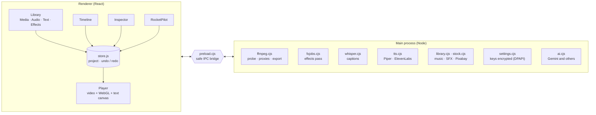

The interface has no Node access and never sees an API key: it talks to the main process only through the small
bridge in `electron/preload.cjs`. Online services are called from the main process, which adds the key there.

### One effect, two renderers

Each effect and transition is written **once** in a tiny expression language (`src/fx/expr.js`). The same source
is compiled two ways:

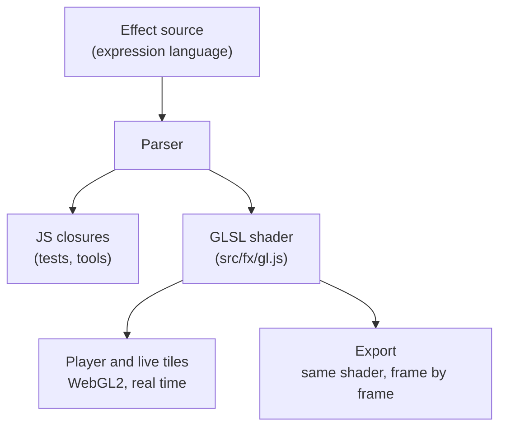

That is why the exported video looks exactly like the player. The compiler never uses `eval` or `new Function`,
so it works under the app's strict Content Security Policy.

### Export pipeline

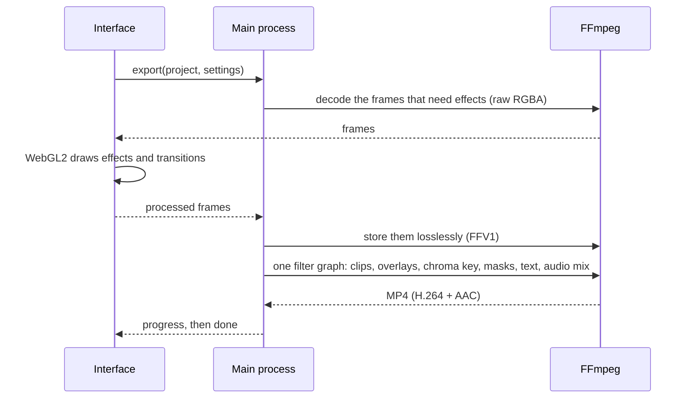

### Text to speech

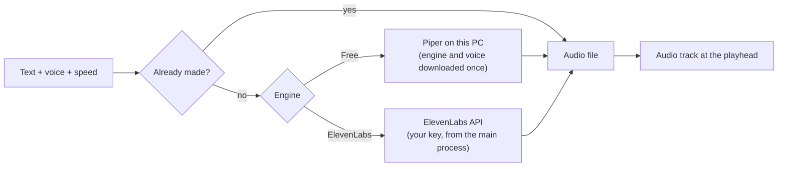

### Project layout

| Path | Role |
|---|---|
| `electron/main.cjs` | Main process: window, IPC, import, export, captions, libraries, settings, AI |
| `electron/preload.cjs` | The only bridge between the interface and the main process |
| `electron/ffmpeg.cjs` | Probing, preview proxies and FFmpeg filter graphs for the export |
| `electron/fxjobs.cjs` + `src/fxExport.js` | Effects pass: FFmpeg decodes frames, WebGL draws the effects, FFmpeg stores them |
| `electron/whisper.cjs` | Downloads whisper.cpp and transcribes audio for captions |
| `electron/tts.cjs` | Text to speech with Piper (local) and ElevenLabs |
| `electron/library.cjs`, `electron/stock.cjs` | Audio library (Openverse, SFXMint, built-ins) and Pixabay stock media |
| `electron/settings.cjs` | Settings and API keys, encrypted with Windows DPAPI |
| `electron/ai.cjs`, `src/agent/` | RocketPilot: model providers, tools and agent loop |
| `src/store.js` | Project model, reducer, undo / redo, magnet and ripple logic |
| `src/fx/` | Effect and transition catalog, expression language, WebGL renderer, live previews |
| `src/text/` | Text renderer shared by the player and the export, templates |
| `src/components/` | Interface: library, player, timeline, inspector, settings |
| `scripts/` | Automated tests |

### Tech stack

| Layer | Tools |
|---|---|
| Desktop shell | Electron, electron-builder (NSIS installer) |
| Interface | React 18, Vite, Lucide icons, Fontsource fonts |
| Graphics | WebGL2 shaders, Canvas 2D for text |
| Media | FFmpeg and FFprobe (`ffmpeg-static`, `ffprobe-static`) |
| Speech | whisper.cpp (captions), Piper (voices), ElevenLabs (optional) |
| AI | Google Gemini (optional, your key) |

## Run from source

Requirements: **Windows 10/11** and **Node.js 18 or newer**.

```bash
git clone https://github.com/medhachim/CapRocket.git
cd CapRocket
npm install
npm start
```

FFmpeg comes with the project (`ffmpeg-static`), nothing else to install. The first time you use auto captions,
CapRocket downloads whisper.cpp and the base speech model (about 150 MB) to `%APPDATA%\CapRocket\whisper`.

### Development
```bash
npm run dev
```
Changes in `src/` appear instantly without losing your project; changes in `electron/` restart the app.

### Build the Windows installer
```bash
npm run dist
```
The installer is written to `release/CapRocket-Setup-<version>.exe`. It lets the user pick the folder and adds
Desktop and Start menu shortcuts. It is not code-signed, so SmartScreen may ask for confirmation the first time.

### Tests
```bash
npm run test:export
```
Other suites: `test:captions`, `test:magnet`, `test:toolbar`, `test:clipmenu`, `test:layers`, `test:fx`,
`test:library`, `test:stock`, `test:favorites`, `test:tts`, `test:ai`, `test:agent`.

UI tests drive the real app with `FVE_SMOKE=<folder> FVE_SMOKE_MODE=<mode> npx electron .` (see `electron/smoke.cjs`)
and never touch your real settings. The screenshots and animations in this README come from the `readme` mode
(`electron/smoke-readme.cjs`).

## API keys and privacy

- Open **Settings** (gear icon, top right) to add keys for the AI assistant (Gemini, Ollama, OpenAI-compatible, Claude), for Pixabay and for ElevenLabs.
- All keys are **optional**: everything else works without an account.
- Keys are encrypted with Windows secure storage (DPAPI) in `%APPDATA%\CapRocket\settings.json`: never written in plain text, never logged, never sent to the interface.
- Captions run offline. Online services only receive what you send them (a search, the text to speak, a request to RocketPilot).
- **Never commit a key to this repository.** If a key is ever exposed, revoke it and create a new one.

## Contributing

Issues and pull requests are welcome. Please:

- keep the app free of paywalls and trackers;
- keep interface text in English;
- never add code or assets taken from CapCut or other apps;
- run the tests that cover your change before opening a pull request.

## Support the project

CapRocket is free and will stay free. If it saves you time or money, you can support its development:

<p><a href="https://ko-fi.com/J3F024TQY1"></a></p>

Starring the repository and sharing the app also help a lot.

## License and credits

CapRocket is released under the **[MIT License](LICENSE)**.

- FFmpeg comes from `ffmpeg-static`, a **GPL** build: if you distribute CapRocket, you must also follow FFmpeg's GPL license.
- Speech recognition: [whisper.cpp](https://github.com/ggerganov/whisper.cpp) and OpenAI's Whisper models (MIT).
- Voices: [Piper](https://github.com/rhasspy/piper) (MIT) with voices under CC0, public domain or CC BY (the Arabic voice's dataset states no licence); [ElevenLabs](https://elevenlabs.io) with your own key, under its terms.
- Online content: music from [Jamendo](https://www.jamendo.com) through [Openverse](https://openverse.org), sound effects from [SFXMint](https://sfxmint.com) and [Freesound](https://freesound.org), stock media from [Pixabay](https://pixabay.com). Each item keeps its own license; CapRocket only lists sounds that may be used in videos and shows the credits CC BY requires.
- The demo footage in these screenshots comes from [Pixabay](https://pixabay.com) (Pixabay Content License).
- Fonts from [Fontsource](https://fontsource.org) (Open Font License). Icons from [Lucide](https://lucide.dev) (ISC).

CapRocket is an independent project. It is **not affiliated with, endorsed by, or connected to CapCut or ByteDance**,
and it contains no CapCut code or assets. "CapCut" is a trademark of its owner, used here only to describe the style of the app.

---

<p align="center">
  <br />
  Made with ♥ by <a href="https://www.instagram.com/medhachim_">MedHachim</a><br />
  <sub>If CapRocket helps you, give it a ⭐ on GitHub or buy me a coffee:</sub><br /><br />
  <a href="https://ko-fi.com/J3F024TQY1"></a>
</p>
